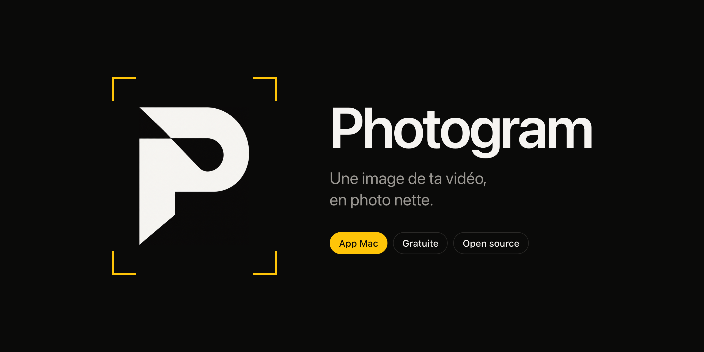

<p align="center"></p>

<p align="center">Une app Mac qui transforme n'importe quelle image d'une vidéo en photo, à la résolution d'origine, cadrée pour Instagram.</p>

---

## Pourquoi c'est plus net qu'une capture d'écran

Une capture d'écran enregistre l'aperçu réduit de ton logiciel de montage. Photogram lit l'image directement dans le fichier vidéo, à sa vraie résolution, puis la recadre au pixel près.

- **L'image exacte** : celle que tu as choisie, pas une image voisine.
- **La résolution native** : 3840 × 2160 pour une vidéo 4K, 1215 × 2160 une fois recadrée en story.
- **L'image la plus nette** : en option, l'app compare l'image choisie avec les deux images avant et après, et garde la plus nette.

## Fonctions

- Glisser une vidéo dans la fenêtre ou sur l'icône (MOV, MP4).
- Naviguer image par image, avec une frise de la vidéo.
- Formats : original, story 9:16, portrait 4:5, carré 1:1, paysage 16:9. Le cadre se déplace à la souris et se resserre avec un curseur.
- Export en JPEG, PNG ou HEIC, dans le dossier de ton choix (par défaut : Images › Photogram).
- Partage direct (par exemple en AirDrop vers ton iPhone), copie en un raccourci, ou glisser-déposer de la photo vers une autre app.
- Alerte si la photo est trop petite pour une story nette.

## Installer

Il faut un Mac sous macOS 14 ou plus récent. Xcode n'est pas nécessaire.

**Avec Claude Code** : colle ce prompt.

```
Installe Photogram depuis https://github.com/gaelcreates/photogram : clone le dépôt, lance ./build.sh, puis ouvre l'app. Si les outils de développement d'Apple manquent, dis-moi de lancer xcode-select --install et attends que je te confirme.
```

**Dans le Terminal** :

```bash
xcode-select --install
git clone https://github.com/gaelcreates/photogram.git
cd photogram
./build.sh
open ~/Applications/Photogram.app
```

La première ligne n'est utile qu'une fois, si les outils d'Apple ne sont pas installés. L'app est compilée sur ton Mac : elle s'ouvre sans l'alerte des apps téléchargées.

## Utiliser

| Action | Raccourci |
| --- | --- |
| Ouvrir une vidéo | ⌘O |
| Image précédente / suivante | ← / → |
| Reculer / avancer d'une seconde | ⇧← / ⇧→ |
| Lecture / pause | Espace |
| Exporter la photo | ⌘E |
| Copier la dernière photo | ⇧⌘C |

## Pour des photos encore plus nettes

L'app ne peut pas retirer le flou que la caméra a enregistré. En 24 images par seconde, on filme en général au 1/50 de seconde : dès que ça bouge, chaque image est un peu floue.

- Pour les plans que tu veux garder en photo, monte la vitesse d'obturation à 1/250 ou plus.
- Filme en 4K : environ 8 millions de pixels par image, contre 2 millions en 1080p.
- Si ta caméra le permet, filme en 50 ou 60 images par seconde.
- Choisis l'instant où le geste s'arrête.

## Comment ça marche

Un seul fichier SwiftUI (`main.swift`), compilé avec `swiftc`. L'image est lue avec `AVAssetImageGenerator` (tolérance de temps nulle, taille maximale non limitée, rotation de la vidéo appliquée). La netteté est mesurée par la variance du laplacien sur une version réduite en niveaux de gris.

Mode test en ligne de commande :

```bash
~/Applications/Photogram.app/Contents/MacOS/Photogram --test video.mp4 1.5 "9:16" dossier_de_sortie
```

## Licence

MIT. Conçu par [Gael Fischer](https://www.instagram.com/gaelcreates/), construit avec Claude.
